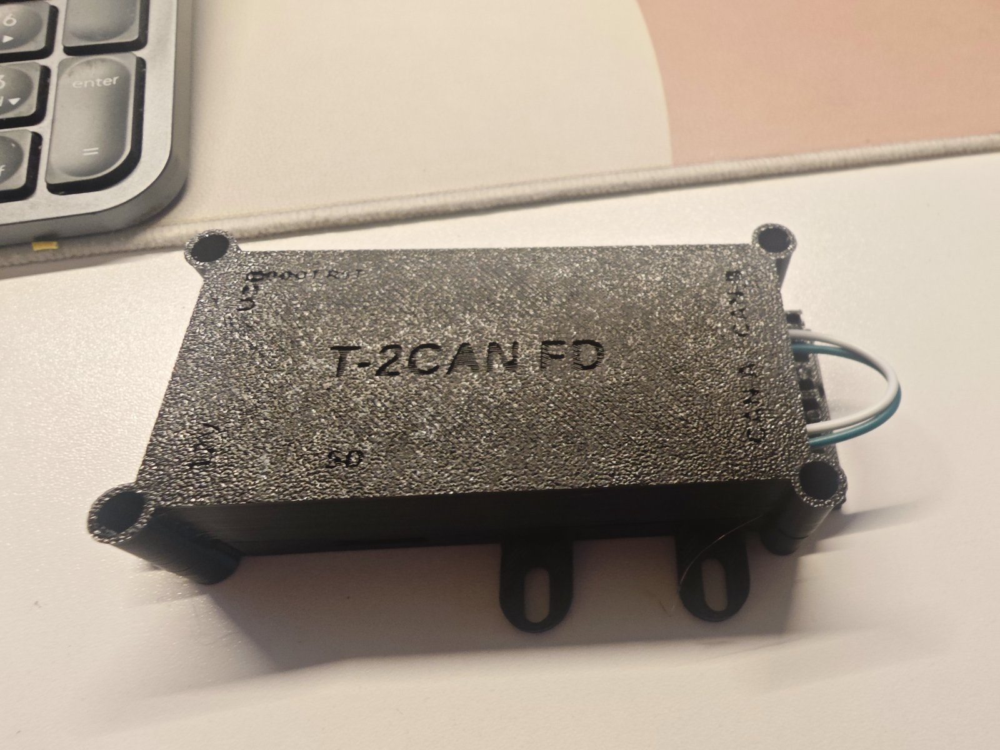
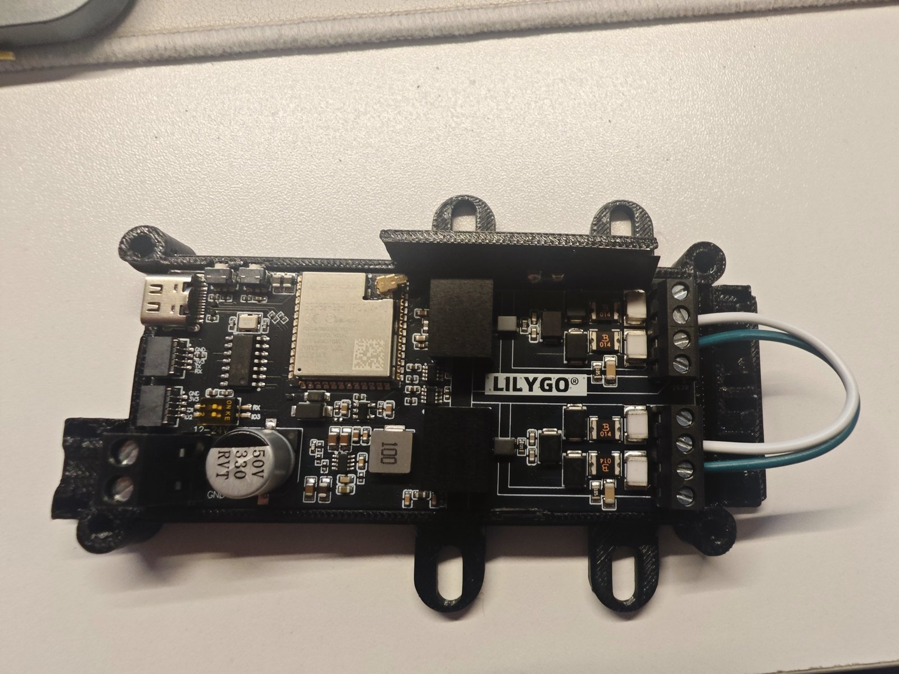
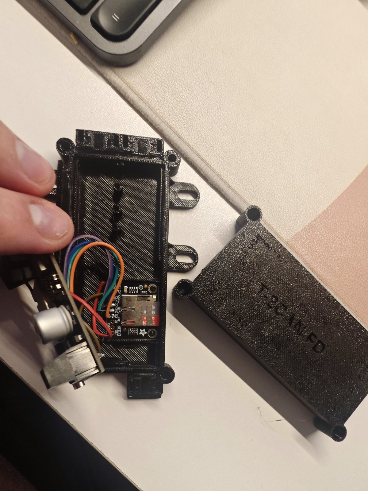

# LilyGo T-2CAN FD enclosure

A two-part, support-free 3D-printed case for in-car use of the LilyGo T-2CAN FD with this firmware. USB-C, the 12–24 V and CAN screw terminals, the BOOT/RST buttons, and an open microSD card slot stay accessible. Version 6, 27 November 2026.

The lid holds the board with short perimeter edge ribs on the bare PCB edges — nothing presses on components in the middle of the board. The optional [Adafruit #4682](https://www.adafruit.com/product/4682) microSD breakout sits in a pocket under the board and is located by two pins that pass through its mounting holes.

*Printed v6, closed.*

*T-2CAN FD seated in the base.*

*Adafruit #4682 in the under-board pocket, with the lid alongside.*

## Files

| File | Contents |
|---|---|
| [`t2can_fd_case.scad`](t2can_fd_case.scad) | Parametric model (OpenSCAD ≥ 2021) |
| [`base.stl`](base.stl) | Base, already in print orientation (floor down) |
| [`lid.stl`](lid.stl) | Lid, already flipped (top face down) |
| [`photos/`](photos/) | Photos of a printed v6 |

## Printing

- **Material:** PETG, or preferably ASA/ABS. Do not use PLA in a car (it warps above about 55 °C).
- **Settings:** 0.2 mm layers, 4 perimeters, 25–30 % gyroid infill, **no supports**.
- **Orientation:** print the base floor-down; print the lid top-down (the STL is already flipped).

Outer body is about **95.5 × 44.1 × 26.1 mm**, larger once you include the corner bosses and mounting ears.

## Hardware

- 4× M3×10 socket-head cap screws
- 4× M3 heat-set inserts (OD about 4.0–4.2 mm)
- Cable ties (≤ 4.8 mm) for the saddles at both ends; 3M Dual Lock or M4 in the mounting ears if you want to fix the case behind trim
- Optional: Adafruit microSD SPI or SDIO breakout **#4682** (3.3 V). The base has two locating pins, Ø 2.25 × 3.2 mm, at 20.3 mm pitch, that go through the 2.6 mm mounting holes
- The included LilyGo 2.4 GHz FPC antenna sticks into a pocket on the inner USB-side wall of the base, with a groove for the short U.FL pigtail. If you use a U.FL-to-SMA pigtail and a whip antenna instead, set `antenna = false` and `sma_bore = true` in the SCAD and re-export the STLs

There is no hinged SD door. Eject the card through the open wall slot (push-push).

## OpenSCAD

Open `t2can_fd_case.scad` and set `part`:

| `part` | What you get |
|---|---|
| `"base"` | Base, print orientation |
| `"lid"` | Lid, print orientation (already flipped) |
| `"assembled"` | Closed case (preview) |
| `"exploded"` | Exploded preview |
| `"section"` | Cross-section at `section_y` |
| `"antenna"` | Base with the FPC antenna pocket highlighted |
| `"build_plate"` | Base and lid laid out for a single print |

Export the current part as STL from OpenSCAD (File → Export → Export as STL). Extra debug values (`lid_underside`, `section_rib`, `collision_base`, `collision_lid`, `collision_parts`) are in the source if you change dimensions and want to re-check clearances.
